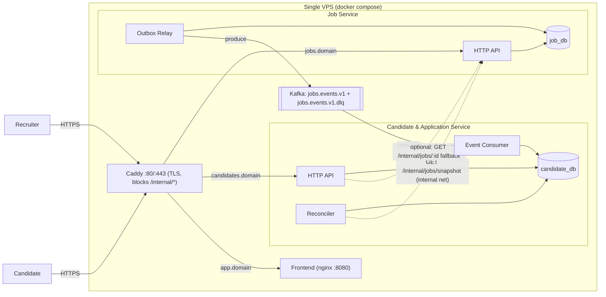

# ARCHITECTURE.md

Design source of truth. If code diverges, update this file in the same commit (see AGENTS.md §9).

**Section index:** 1 Overview · 2 Diagrams · 3 Service boundaries · 4 Data models · 5 Event contract · 6 Reliability · 7 Search · 8 API surface · 9 Auth & security · 10 Deployment & CI/CD · 11 Infrastructure request · 12 Observability · 13 Non-goals · 14 Requirement traceability

---

## 1. Overview

Two independently deployable services, each with its own PostgreSQL database and its own subdomain, connected by Kafka (async) and a small internal HTTP API (sync, used only for reconciliation and an optional fallback).

| | Job Service | Candidate & Application Service |
|---|---|---|
| Domain | `jobs.<domain>` | `candidates.<domain>` |
| Port (internal) | 3001 | 3002 |
| Database | `job_db` (own Postgres container) | `candidate_db` (own Postgres container) |
| Owns | recruiters, jobs, outbox | candidates, applications, **replica** of jobs |
| Kafka role | Producer (via outbox relay) | Consumer (+ DLQ producer) |
| Search | FTS over source-of-truth jobs (public, published only) | FTS over local replica (primary candidate-facing search) |

**Key idea:** the Candidate Service is fully functional (search, apply, history) with Kafka *and* the Job Service completely down, because it works off its local replica. Kafka only keeps the replica fresh; reconciliation guarantees the replica converges even if events were lost.

**Stack:** Python 3.12 + Django 5 + Django REST Framework, `django.contrib.postgres` (ORM + SQL-level FTS), Django migrations, `confluent-kafka`, PostgreSQL 16, `apache/kafka` KRaft, Vite + React frontend, Caddy, Docker Compose, GitHub Actions, `uv` for packaging. (Chosen for agent reliability and a low memory footprint; a JVM stack would roughly double the RAM request. Changing the stack means editing this line, AGENTS.md §2 and the infra numbers in §11.)

---

## 2. Diagrams

### 2.1 Components



### 2.2 Publish flow (happy path and outage)

```mermaid
sequenceDiagram
  participant Rec as Recruiter
  participant JS as Job Service
  participant DB as job_db
  participant RL as Outbox Relay
  participant K as Kafka
  participant CS as Candidate Consumer
  participant CDB as candidate_db
  Rec->>JS: POST /recruiter/jobs/{id}/publish
  JS->>DB: BEGIN; UPDATE jobs (status, version+1); INSERT outbox_events; COMMIT
  JS-->>Rec: 200 (never waits on Kafka)
  loop every ~500ms
    RL->>DB: SELECT pending FOR UPDATE SKIP LOCKED (under advisory lock)
    RL->>K: produce JobPublished (key=jobId, acks=all, idempotent)
    alt Kafka down
      RL->>DB: attempts++, last_error, next_attempt_at (backoff)
    else ok
      RL->>DB: published_at = now()
    end
  end
  K->>CS: deliver event
  CS->>CDB: BEGIN; INSERT processed_events ON CONFLICT DO NOTHING; UPSERT jobs WHERE incoming.version > stored.version; COMMIT
  Note over CS,K: transient error: retry 3x w/ backoff. Still failing or invalid: DLQ, then continue
```

---

## 3. Service boundaries

- **Job Service** owns the lifecycle `DRAFT -> PUBLISHED -> CLOSED` (no unpublish, CLOSED is terminal). It is the single writer of job truth.
- **Candidate Service** never writes job truth. Its `jobs` table is a **read replica built from events** (plus reconciliation). Applications reference it.
- **Recruiter "view applications"** is served by the Candidate Service (it owns applications). It accepts the recruiter's JWT (issued by Job Service, verified with Job Service's public key from env) and checks ownership via `jobs.recruiter_id` in its replica. No synchronous call to Job Service is needed.
- **Shared code** is limited to `backend/packages/contracts` (event schemas, topic names). It is a compile-time contract, not a runtime dependency; each Docker image bundles its own copy.

---

## 4. Data models (PostgreSQL)

### 4.1 `job_db`

```
recruiters(id uuid pk, email text, password_hash text, full_name, company_name, phone, created_at, updated_at)
  UNIQUE INDEX on lower(email)

jobs(id uuid pk, recruiter_id uuid fk, title, description, company, location,
     employment_type text check in (FULL_TIME,PART_TIME,CONTRACT,INTERNSHIP,TEMPORARY),
     skills text[], status text check in (DRAFT,PUBLISHED,CLOSED),
     version int not null default 1,           -- bumped on EVERY write
     published_at, closed_at, created_at, updated_at,
     search_vector tsvector)                   -- maintained by trigger (see §7)

outbox_events(id bigserial pk, event_id uuid unique, aggregate_id uuid, aggregate_version int,
              event_type text, payload jsonb, created_at timestamptz,
              published_at timestamptz null, attempts int default 0,
              last_error text null, next_attempt_at timestamptz default now())
  PARTIAL INDEX (next_attempt_at, id) WHERE published_at IS NULL
```

Outbox rows are written only for: first publish, update while `PUBLISHED`, close. DRAFT edits bump `version` but emit nothing (version gaps are expected and harmless).

### 4.2 `candidate_db`

```
candidates(id uuid pk, email, password_hash, full_name, phone, headline, location,
           skills text[], summary, resume_url,
           resume_file text null, resume_filename text null, resume_uploaded_at timestamptz null,
           created_at, updated_at)   -- UNIQUE lower(email); file lives on the candidate media volume

jobs(id uuid pk /* = source job id */, recruiter_id, title, description, company, location,
     employment_type, skills text[], status, version int, published_at, closed_at,
     source_updated_at, synced_at, search_vector tsvector)

applications(id uuid pk, candidate_id fk, job_id fk -> jobs.id,
             status text check in (SUBMITTED,IN_REVIEW,SHORTLISTED,REJECTED,ACCEPTED),
             cover_letter, job_title_snapshot, company_snapshot,
             applied_at, status_updated_at,
             UNIQUE (candidate_id, job_id))                    -- invariant I7

processed_events(event_id uuid pk, event_type, processed_at)   -- inbox / dedup
consumer_status(id smallint pk /* always 1 */, status, last_error, processed, dlq_count, last_heartbeat_at)
                                                              -- consumer heartbeat read by /readyz
reconcile_runs(id bigserial pk, mode text, started_at, finished_at, checked int, repaired int, error text null)
```

Drafts are never replicated (the snapshot and events only cover `PUBLISHED`/`CLOSED`).

---

## 5. Event contract (`backend/packages/contracts`)

**Topics**
- `jobs.events.v1`: 3 partitions, replication 1 (single broker), key = `jobId` (per-job ordering), retention 7 days.
- `jobs.events.v1.dlq`: 1 partition, retention 30 days.

**Envelope (all events)**
```json
{
  "eventId": "uuid",
  "eventType": "JobPublished | JobUpdated | JobClosed",
  "schemaVersion": 1,
  "aggregateId": "jobId uuid",
  "aggregateVersion": 7,
  "occurredAt": "2026-01-01T10:00:00.000Z",
  "payload": { "...full job snapshot..." }
}
```

**Payload = full state snapshot** (not a diff): `id, recruiterId, title, description, company, location, employmentType, skills[], status, version, publishedAt, closedAt, updatedAt`. Full snapshots make the consumer a simple version-guarded upsert, safe under loss, duplication and reordering, and let reconciliation reuse the very same upsert.

**Rules**
- Adding optional fields = backward compatible. Breaking change = new topic `jobs.events.v2` + new `schemaVersion`.
- Kafka headers: `event-type`, `event-id`, `schema-version`.
- DLQ message = original value + headers `dlq-error`, `dlq-attempts`, `dlq-source-topic`, `dlq-source-partition`, `dlq-source-offset`, `dlq-failed-at`.

---

## 6. Reliability design (the most important section)

### 6.1 Transactional outbox (producer side)
1. State change + `INSERT outbox_events` in **one transaction** (`withTx` helper used by every command that emits events).
2. **Relay** (background loop inside Job Service, `OUTBOX_RELAY_ENABLED`, default on): takes a Postgres **advisory lock** (single active relay), selects pending rows `WHERE published_at IS NULL AND next_attempt_at <= now() ORDER BY id LIMIT 100 FOR UPDATE SKIP LOCKED`, publishes sequentially in order, marks `published_at` per row after broker ack.
3. On failure: `attempts++`, `last_error`, `next_attempt_at = now() + min(2^attempts s, 30 s)`; stop the batch (preserve order), keep looping. When Kafka returns, the backlog drains automatically.
4. Producer: `acks=all`, idempotent producer, key = aggregateId. Delivery is **at-least-once** (crash between ack and `published_at` update republishes); the consumer dedups.
5. Visibility: `GET /internal/admin/outbox` returns `{ pending, oldestPendingAgeSeconds, lastError, publishedLastHour }`.

### 6.2 Consumer (Candidate Service)
- Group `candidate-service`, `fromBeginning: true`, manual error handling so a poison message can never block the partition.
- Per message, in **one DB transaction**: `INSERT processed_events ... ON CONFLICT DO NOTHING` (0 rows -> duplicate, skip) then version-guarded upsert:
  ```sql
  INSERT INTO jobs (...) VALUES (...)
  ON CONFLICT (id) DO UPDATE SET ... , synced_at = now()
  WHERE jobs.version < EXCLUDED.version;
  ```
- **Retries:** transient errors (DB connection, deadlock): 3 attempts, backoff 200 ms / 1 s / 5 s.
- **Non-retryable** (pydantic validation failure, unknown schemaVersion): straight to DLQ.
- After retries exhausted: publish to `jobs.events.v1.dlq` with diagnostic headers, then commit the offset and continue.
- **DLQ replay:** `scripts/replay-dlq.ts [--dry-run] [--limit N]` re-publishes DLQ messages to the main topic (the handler is idempotent, so replay is always safe).

### 6.3 Reconciliation (Candidate Service)
- Job Service exposes `GET /internal/jobs/snapshot?after=<uuid>&limit=500` returning full payloads for `status != DRAFT`, keyset-paginated by `id`.
- Reconciler pages through it and compares `(id, version)` to local rows; missing or older rows are upserted through **the same function the consumer uses**. Local rows absent from the source are an anomaly: logged `WARN`, never auto-deleted.
- Modes: `full` (30 s after boot, nightly, and on demand), `incremental` (every 5 min; uses `updated_at >= lastRun - 10 min` overlap window). On demand: `POST /internal/admin/reconcile?mode=full`. Every run writes `reconcile_runs`.
- Status: `GET /internal/admin/sync-status` -> `{ lastRun, lastRepaired, localJobCount, ... }`.

### 6.4 Failure matrix

| Failure | Behaviour | Recovery |
|---|---|---|
| Kafka down during publish/update/close | API succeeds; outbox rows stay pending; Candidate side serves stale-but-valid replica | Relay drains automatically in order after Kafka returns |
| Job Service crashes after commit, before publish | Outbox row persisted | Relay publishes on restart |
| Crash after Kafka ack, before `published_at` | Event republished (duplicate) | Consumer dedups via `processed_events` + version guard |
| Candidate Service down | Events accumulate in Kafka | Consumer resumes from committed offset |
| Poison/invalid event | Retried or fast-failed, sent to DLQ, partition keeps moving | Fix, then `replay-dlq` |
| Events lost (topic wiped, offsets reset, retention exceeded) | Replica stale | Reconciler detects version drift and repairs |
| Out-of-order delivery | Older version ignored by version guard | None needed |
| Job Service down, Kafka up | Candidate side fully works from replica | n/a |

### 6.5 Proof requirement
`make e2e` and `scripts/demo-kafka-outage.sh` execute scenarios A-E (see CONTEXT.md M6) and end with a consistency assertion: the set of `(id, version, status)` for non-draft jobs is identical in both services. Transcripts are stored in `docs/outage-recovery.md`.

---

## 7. Search (PostgreSQL FTS)

**Both services** carry the same search design (copy, not a shared lib):

- `search_vector` maintained by a **BEFORE INSERT OR UPDATE trigger** (not a generated column: `array_to_string` is only STABLE, so it is rejected in generated-column expressions):
  ```sql
  NEW.search_vector :=
      setweight(to_tsvector('english', coalesce(NEW.title,'')),   'A')
   || setweight(to_tsvector('english', array_to_string(NEW.skills,' ')), 'B')
   || setweight(to_tsvector('english', coalesce(NEW.company,'')), 'B')
   || setweight(to_tsvector('english', coalesce(NEW.description,'')), 'C');
  ```
- **Indexes**
  - `GIN (search_vector) WHERE status = 'PUBLISHED'` (partial: smaller, and the filter is baked in)
  - `GIN (skills)` for `skills @> ARRAY[...]` filtering
  - `BTREE (published_at DESC, id) WHERE status='PUBLISHED'` for empty-query browse and tie-breaking
  - `BTREE (employment_type)`, `BTREE (lower(location))` for filters
- **Query**
  ```sql
  SELECT id, title, company, location, employment_type, skills, published_at,
         ts_rank_cd(search_vector, q) AS rank
  FROM jobs, websearch_to_tsquery('english', $1) q
  WHERE status = 'PUBLISHED' AND search_vector @@ q
        [AND employment_type = $2] [AND lower(location) = lower($3)] [AND skills @> $4]
  ORDER BY rank DESC, published_at DESC NULLS LAST, id
  LIMIT $n OFFSET $m;
  ```
  `status = 'PUBLISHED'` must appear literally so the planner can use the partial index. Empty `q` -> browse query ordered by `published_at DESC NULLS LAST`. `NULLS LAST` keeps rows whose `published_at` was never stamped (test fixtures, manual inserts) out of the top of the browse order. `total` via a separate bounded `COUNT(*)`.
- **Ordering:** relevance (weighted rank: title > skills/company > description), then recency, then id for stable pagination.
- **Evidence:** `docs/search-performance.md` has the strategy and `EXPLAIN (ANALYZE, BUFFERS)` on a 100k-row seed: before (Seq Scan) vs after (Bitmap Index Scan on the GIN index), for at least 3 queries.

---

## 8. API surface (summary; full OpenAPI generated at `/docs`)

**Job Service (`jobs.<domain>`)**
- `POST /auth/recruiters/register` · `POST /auth/recruiters/login` · `POST /auth/recruiters/refresh` · `GET|PUT /recruiters/me`
- `GET /recruiter/dashboard` (job counts by status + recent jobs)
- `POST /recruiter/jobs` (creates DRAFT) · `GET /recruiter/jobs` · `GET|PUT /recruiter/jobs/:id` · `POST /recruiter/jobs/:id/publish` · `POST /recruiter/jobs/:id/close`
- Public: `GET /jobs` (search/browse, PUBLISHED only) · `GET /jobs/:id` (PUBLISHED only)
- Internal: `GET /internal/jobs/snapshot` · `GET /internal/jobs/:id` · `GET /internal/admin/outbox`
- `GET /healthz` (liveness) · `GET /readyz` (DB required; Kafka reported, never fails readiness)

**Candidate & Application Service (`candidates.<domain>`)**
- `POST /auth/candidates/register` · `POST /auth/candidates/login` · `POST /auth/candidates/refresh` · `GET|PUT /candidates/me`
- `GET /candidates/me/dashboard` · `GET /candidates/me/resume` · `POST|DELETE /candidates/me/resume` (PDF, <= 5 MiB)
- `GET /jobs` (search replica) · `GET /jobs/:id`
- `POST /jobs/:id/applications` (apply; 409 `APPLICATION_ALREADY_EXISTS`, 409 `JOB_NOT_OPEN`, 404 `JOB_NOT_FOUND`)
- `GET /candidates/me/applications` · `GET /candidates/me/applications/:id`
- Recruiter (Job-Service-issued JWT): `GET /recruiter/dashboard` · `GET /recruiter/application-counts` · `GET /recruiter/jobs/:jobId/applications` · `GET /recruiter/applications/:id` · `PATCH /recruiter/applications/:id/status` · `GET /recruiter/applications/:id/resume`
- Internal: `POST /internal/admin/reconcile` · `GET /internal/admin/sync-status` · `POST /internal/admin/dlq/replay`
- `GET /healthz` · `GET /readyz`

---

## 9. Auth & security

- Passwords: argon2id (`argon2-cffi`, Django's default hasher). Access tokens: JWT (ES256/RS256) via `djangorestframework-simplejwt`, 1 h, claims `sub`, `role` (`recruiter`|`candidate`), `iss`; refresh tokens last 7 days and are exchanged at `POST /auth/{recruiters,candidates}/refresh` (M7A). Each service signs its own users' tokens and holds the **peer's public key** (env, base64-encoded PEM) to accept recruiter tokens in the Candidate Service. Role is checked on every route.
- Ownership checks: recruiters touch only their jobs; candidates only their applications.
- Internal calls: `X-Internal-Token` (random 32+ bytes, env), constant-time compare. Caddy returns 404 for `/internal/*` from outside; services talk over the private docker network.
- Hardening: Django security middleware + CORS allowlist, DRF throttling on auth routes, serializers on all inputs, ORM/parameterized SQL only, body size limit, log redaction, generic auth errors (no user enumeration), non-root containers, DB roles per service, Postgres and Kafka not published to the host network.
- Secrets: GitHub Environment secrets -> rendered to `/opt/jobportal/.env` (chmod 600) on the VPS by the deploy script. Never baked into images.

---

## 10. Deployment & CI/CD

**Topology (single VPS):** `caddy` (only container with published ports 80/443) · `frontend` (nginx, static bundle) · `job-service` · `candidate-service` · `job-relay` · `candidate-consumer` · `candidate-reconciler` · `job-db` · `candidate-db` · `kafka`; one-shot `job-migrate` / `candidate-migrate`. Three domains from env: `jobs.*`, `candidates.*`, `app.*`. Private docker network, named volumes, `json-file` log driver (`max-size 10m`, `max-file 3`), `restart: unless-stopped`, `mem_limit` per container. The Candidate Service writes uploaded CVs to a named `candidate-media` volume mounted at `MEDIA_ROOT`; the nightly backup includes that volume (M7A).

**ci.yml (PR + push):** `uv lock --check` + lint + typecheck -> unit + integration tests -> **migration check** (fresh DB `migrate`, reverse the latest migration, forward again; fail if `makemigrations --check` reports drift) -> committed-migration immutability check -> frontend build -> Docker image build (no push on PRs) -> `actionlint` + secret scan -> e2e outage suite on `main`.

**deploy.yml (pending, human-owned):** build + push images to GHCR tagged `:<sha>` and `:latest` -> SSH to VPS -> `deploy.sh <sha>`:
1. record current tag to `.previous_tag`
2. `docker compose pull`
3. run migrations (one-shot containers)
4. `docker compose up -d`
5. poll `/readyz` (both services, 60 s timeout) + run `scripts/smoke.sh`
6. on failure: `rollback.sh` (redeploy `.previous_tag`; migrations are expand/contract so older code still runs) and exit non-zero.

**Recovery docs:** `docs/runbook.md` covers manual rollback, DB restore from nightly `pg_dump` (cron, 7-day retention), Kafka volume loss (-> reconcile), DLQ replay, relay stuck, cert issues.

**Health & logs:** `/healthz` and `/readyz` plus compose healthchecks (`python -c "import urllib.request,sys; sys.exit(0 if urllib.request.urlopen('http://localhost:3001/healthz').status==200 else 1)"`, since `-slim` has no curl); JSON logs via stdlib `logging`; `docker compose logs -f`.

---

## 11. Infrastructure request (send to DevOps; also goes into `docs/PROPOSAL.md`)

**Workload assumptions:** up to ~500 registered users, ~50 concurrent, <= 20 req/s peak, <= 100k job rows (seeded for the search benchmark), <= 500k applications, event rate < 5/s. Demo/evaluation scale, not production scale.

**Requested VPS**

| Resource | Request | Minimum acceptable |
|---|---|---|
| CPU | **4 vCPU** | 2 vCPU |
| RAM | **8 GB** | 4 GB + 2 GB swap |
| Storage | **80 GB SSD/NVMe** | 50 GB |
| OS | **Ubuntu 24.04 LTS (x86_64)** | Ubuntu 22.04 LTS |

**Memory budget (justification)**

| Component | Approx. RAM |
|---|---|
| Kafka (KRaft, heap 512 MB + overhead) | 0.8-1.0 GB |
| `job-db` Postgres (shared_buffers 256 MB) | 0.5 GB |
| `candidate-db` Postgres (shared_buffers 256 MB; holds 100k-row FTS index) | 0.5-0.7 GB |
| 2 Django services behind gunicorn (~200-350 MB each) | 0.7 GB |
| Frontend (Vite static bundle behind nginx) | 0.15 GB |
| Caddy | 0.05 GB |
| OS + Docker daemon + page cache | 0.8 GB |
| **Subtotal** | **~3.6-4.1 GB** |
| Headroom (deploy overlap during image pull/restart, seeding, `EXPLAIN ANALYZE`, spikes) | 4 GB |

4 GB works but is tight during deploys; 8 GB is the recommendation. CPU: 2 vCPU is enough steady-state; 4 gives room for the 100k seed + GIN build + concurrent deploy.

**Storage justification:** OS+Docker ~10 GB, images ~3 GB (keep last 3 tags), Postgres data < 3 GB at assumed scale, Kafka < 1 GB (7-day retention), CV media on the candidate volume (capped at 5 MiB per file), logs capped ~300 MB, backups ~5-10 GB, headroom for growth.

**Domains / DNS:** `jobs.<domain>`, `candidates.<domain>` and `app.<domain>`, `A` records to the VPS IP (and `AAAA` if IPv6). DNS must resolve **before** first deploy so Caddy can obtain Let's Encrypt certificates.

**Additional requirements**
- Inbound: 22 (restricted to known IPs if possible), 80, 443. Nothing else public (no 5432, no 9092).
- A non-root `deploy` user with Docker permissions and the CI SSH public key; Docker Engine + Compose plugin (I can provide a bootstrap script).
- Outbound internet (GHCR, Let's Encrypt, apt).
- Optional: off-box backup target (object storage or second host) for `pg_dump`; a DNS API token only if wildcard certs are wanted.

**PostgreSQL and Kafka: same VPS or separate?**

| | Same VPS (recommended for this assignment) | Separate infrastructure |
|---|---|---|
| Cost / ops | Lowest; one host, one compose file, simple CI deploy | More hosts, networking, secrets, firewall rules |
| Latency | Local docker network | Network hop; TLS/auth needed |
| Isolation | Weaker: noisy neighbour (Kafka/Postgres/Node share RAM+disk); VPS loss = total loss | Strong: independent scaling and failure domains |
| Durability | Mitigated with nightly `pg_dump`; Kafka is rebuildable via reconciliation | Managed Postgres/Kafka give PITR, replication, 3-broker HA |
| Data ownership | Still satisfied: two separate Postgres containers/credentials, no cross-DB access | Same |

Recommendation: single VPS, **separate containers and volumes per datastore**, for this assignment. For real production: managed Postgres (one instance or cluster per service) and a managed or 3-broker Kafka, services stay on the app host. Our design already tolerates Kafka loss thanks to the outbox and reconciliation.

---

## 12. Observability

- stdlib `logging` with a JSON formatter, `component` + `event` fields; request id per HTTP request.
- Admin status endpoints (§6) for outbox backlog, sync status, DLQ replay.
- Compose healthchecks; `docker compose ps` is the first diagnostic in the runbook.
- (P1) `/metrics` (Prometheus format) for outbox pending, consumer lag, DLQ count.

## 13. Non-goals

No email, payments, multi-region, Kafka HA, schema registry, or service mesh. Resume is a URL string, plus an optional PDF upload (<= 5 MiB) stored on the Candidate Service media volume and served only through guarded endpoints (M7A, human-directed exception). A React frontend (Vite) is in scope; see AGENTS.md §2 and CONTEXT.md Decisions.

## 14. Requirement traceability (fill in "Evidence" during M9)

| Assignment requirement | Where | Evidence |
|---|---|---|
| Recruiter register/login/profile; job create/publish/update/close | §8, M2 | |
| Candidate register/login/profile; search; apply; history; no duplicate apply | §4.2 (UNIQUE), §8, M4 | |
| Two services, own DBs, own domains, no cross-DB access | §1, §3, I1 | |
| Kafka events JobPublished/Updated/Closed; consumer updates local data | §5, §6.2 | |
| Outbox, retries, idempotency, DLQ, reconciliation | §6 | |
| Demonstrated recovery from Kafka outage | §6.5, M6, `docs/outage-recovery.md` | |
| FTS with tsvector/tsquery, GIN, pagination, ranking, exclude unpublished/closed | §7 | |
| EXPLAIN ANALYZE demonstration + indexing strategy explanation | `docs/search-performance.md` | |
| CI/CD: build, migration check, deploy, secrets, rollback, health, logging | §10 | |
| Dockerfiles, deployment config, instructions | `deploy/`, README | |
| Architecture diagram + docs, API docs, URLs, README | §2, `docs/API.md`, README | |
| Infra request incl. CPU/RAM/storage/OS/domains + PG/Kafka placement trade-offs | §11, `docs/PROPOSAL.md` | |
