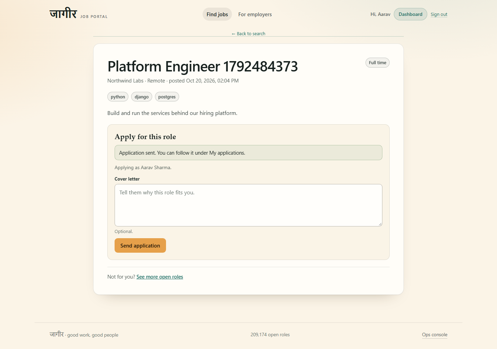
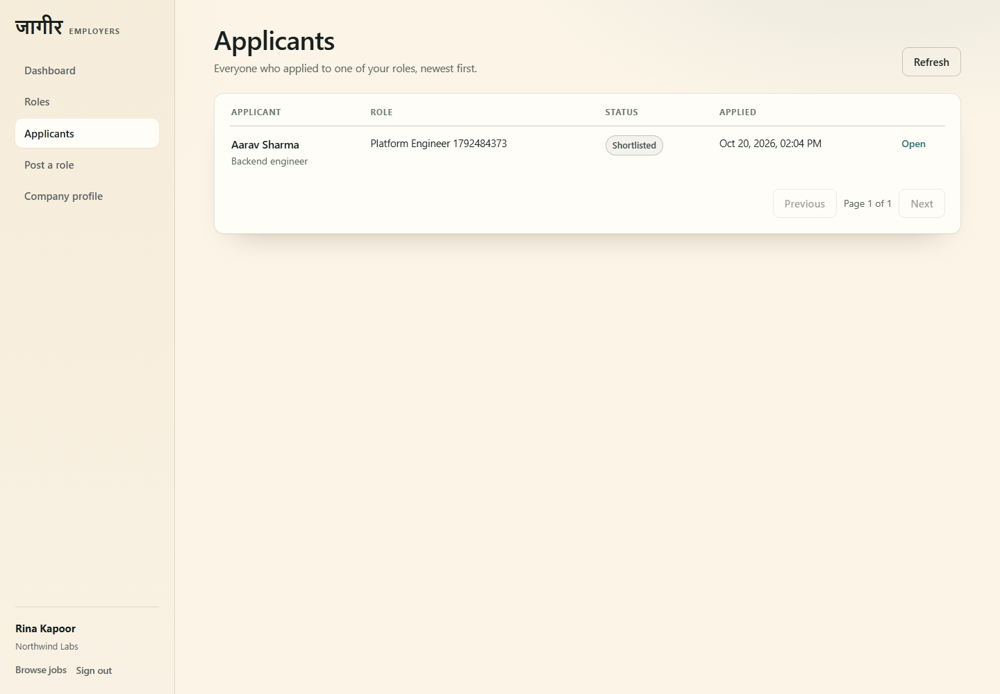
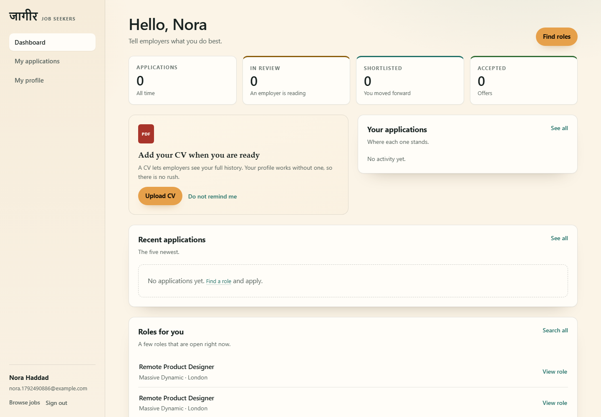
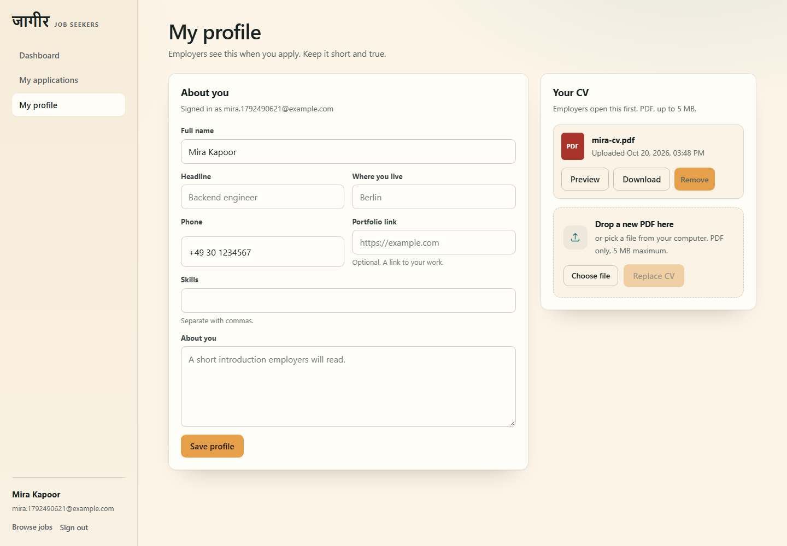
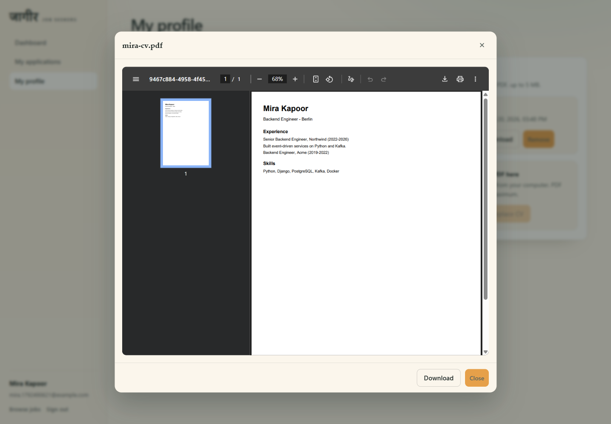

# Job Portal

Two Kafka-connected microservices on PostgreSQL, with a React frontend.

| Component | Stack | Port |
|---|---|---|
| Frontend | React (static build in nginx) | 5174 |
| Job Service | Django 5 + DRF | 3001 |
| Candidate & Application Service | Django 5 + DRF | 3002 |
| Job DB | PostgreSQL 16 | 5433 |
| Candidate DB | PostgreSQL 16 | 5434 |
| Kafka | apache/kafka (KRaft, single node) | 9092 |

Requirements source of truth: `docs/ASSIGNMENT.md`.
Design: `ARCHITECTURE.md`. Work queue and status: `CONTEXT.md`. Agent rules: `AGENTS.md`.

## Status

M1-M6 complete, M7 in progress (frontend image + admin console done). See `CONTEXT.md` > Status board.

## Local setup (one command, all containers)

Prerequisite: Docker with Compose v2.20+ (needed for `include:`) and both service env files.

```
cp backend/services/job-service/.env.example backend/services/job-service/.env
cp backend/services/candidate-service/.env.example backend/services/candidate-service/.env
docker compose build
docker compose up -d
```

Open `http://localhost:5174` for the public site (`/`, `/jobs`, `/employers`, `/me`) and `http://localhost:5174/admin` for the technical ops console.
APIs: `http://localhost:3001`, `http://localhost:3002`, docs at `/docs` on each.

No host Node process is needed. Rebuild with `docker compose build` after a code or `VITE_*` change, then `docker compose up -d`.
Logs: `docker compose logs -f [service]`. Stop: `docker compose down` (add `-v` to wipe data).

`tasks.ps1 stack-up` / `make stack-up` is the same compose project with a build step.

## Screenshots




### Recruiter portal





### Job seeker portal







### Operations


